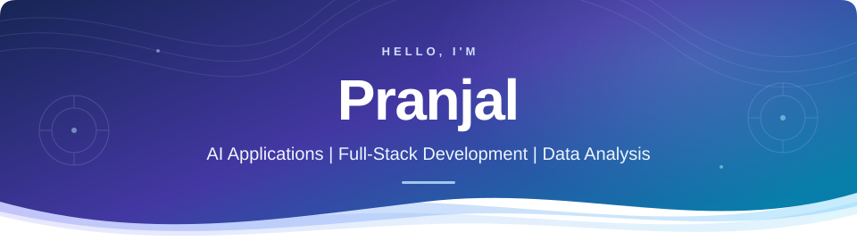

<picture>
  <source media="(prefers-color-scheme: dark)" srcset="assets/banner-dark.svg">
  <source media="(prefers-color-scheme: light)" srcset="assets/banner-light.svg">
  
</picture>

<!-- CONTACT BUTTONS: Replace each #connect below when ready.
     LinkedIn: https://www.linkedin.com/in/YOUR_LINKEDIN_HANDLE/
     LeetCode: https://leetcode.com/u/YOUR_LEETCODE_HANDLE/
     Email: mailto:YOUR_EMAIL@example.com
     Then remove the 'Contact links coming soon' line in the Connect section.
-->

---

## About me

I build AI-powered tools that turn conversations and research into useful insights. My work combines data analysis, evidence-backed answers, and practical web interfaces.

- **AI applications** — Grounded Q&A and retrieval across chats and research documents.
- **Full-stack development** — React interfaces backed by Node.js and Python APIs.
- **Data analysis** — Conversation analytics and hands-on NumPy and Pandas notebooks.

**Across my projects:** useful answers, traceable evidence, and clear interfaces.

---

## Tech stack

### Languages & web

### APIs & development

### Data & AI

Retrieval-based Q&A · Evidence search · Jupyter notebooks

---

<!-- KAGGLE-ACHIEVEMENTS:START -->
## Kaggle achievements

| Competition | Achieved position | Technical work |
|---|---:|---|
| [Petals to the Metal](https://github.com/pranjalsinggh/kaggle-achievements/tree/main/projects/petals-to-the-metal) | **12 / 50 teams** · **0.94693 macro F1** | 104-class EfficientNet ensemble, mixed-precision training on two T4 GPUs, four-view prediction averaging |
| [Connect X](https://github.com/pranjalsinggh/kaggle-achievements/tree/main/projects/connect-x) | **41 / 255 teams** | Native C++ bitboard agent, iterative deepening, alpha-beta pruning, transposition caching |

October 25, 2026 snapshot of ongoing Getting Started leaderboards; ranks can change.

**[Explore the code, methods, results, and screenshot evidence →](https://github.com/pranjalsinggh/kaggle-achievements)** · [Kaggle profile](https://www.kaggle.com/pranjalsinggh)
<!-- KAGGLE-ACHIEVEMENTS:END -->

---

## Featured projects

### 01 · ChatScope

**Conversation analytics & grounded AI**

Turn WhatsApp exports into interactive analytics and evidence-backed answers.

**Inside the project**

- Conversation trends, response-time analysis, and interactive visualizations.
- Message search and retrieval-backed Q&A in English, Hindi, and Hinglish.
- A React dashboard paired with a Node.js/Express API and Gemini integration.

**Built with:** React · TypeScript · Node.js · Express · Recharts · Gemini

### 02 · ScholarScout

**PDF research & evidence retrieval**

Explore research PDFs with source-linked analysis, evidence search, and related-paper discovery.

**Inside the project**

- Local PDF retrieval using TF-IDF and BM25.
- Optional AI synthesis grounded in retrieved evidence.
- Literature discovery through OpenAlex, Crossref, and arXiv integrations.

**Built with:** Python · FastAPI · React · TypeScript · PyMuPDF · scikit-learn

---

## Data science notebooks

Hands-on practice with the foundations behind data analysis:

- **[NumPy](https://github.com/pranjalsinggh/Numpy-Begineer)** — Arrays, broadcasting, statistics, and vectorization.
- **[Pandas](https://github.com/pranjalsinggh/Pandas-1)** — Data cleaning, transformations, grouping, and joins.

---

## GitHub activity

 

[View my contribution graph](https://github.com/pranjalsinggh#js-contribution-activity-description) · [Browse all repositories](https://github.com/pranjalsinggh?tab=repositories)

---

## Connect

Contact links coming soon.

**From raw data to useful answers.**

